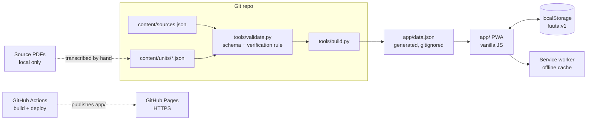

# Architecture

Fuuta is a static, offline-first PWA for everyday Mauritanian Pulaar. There is no backend: lesson content is validated JSON compiled into one file the app loads, and progress lives in the phone's `localStorage`.

> Diagram link (LeanIX): not applicable, this is a personal project. The diagram below is the source of truth.

## Components
| Component | Location | Role |
|---|---|---|
| Content | `content/` | Sources registry and lesson units (items = words and phrases) |
| Schemas | `schema/` | JSON Schema for sources and units |
| Validator | `tools/validate.py` | Schema, unique ids, known sources, "verified needs a Mauritanian source" |
| Builder | `tools/build.py` | Runs the validator, drops `unverified` items and `variants`, writes `app/data.json` |
| Deploy | `.github/workflows/pages.yml` | Builds and publishes `app/` to GitHub Pages on push to `main` ([ADR 0005](adr/0005-github-pages-hosting.md)) |
| Icons | `tools/make_icons.py` | Dependency-free PNG icon generation |
| App | `app/` | `index.html`, `styles.css`, `app.js`, `sw.js`, manifest |

## App views
Learn (flashcards, spaced review), Path (units, phrasebook, search), Quiz (multiple choice both directions), Progress. Routing is hash-based (`#/learn`, `#/path`, `#/unit/<id>`, `#/quiz`, `#/progress`). Study and quiz sessions are in-memory overlays.

## Constraints
- Only Mauritanian Pulaar is shown. Other regions are comparison data in `variants` and never ship (see [ADR 0003](adr/0003-mauritanian-only-verification.md)).
- Must work offline in Mauritania, so no runtime network dependencies and no external fonts or CDNs.
- No audio yet; no accounts or sync.
